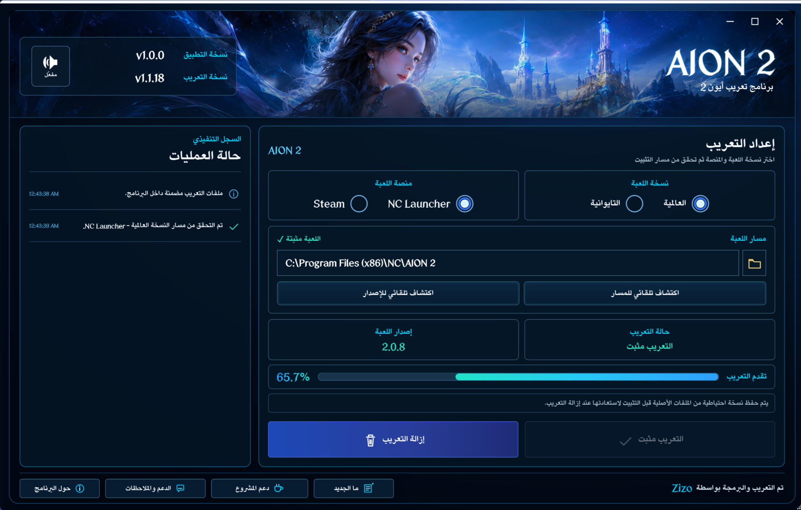

# Aion2AR | أيون 2 بالعربية

### برنامج تعريب AION 2 إلى اللغة العربية

 

 

برنامج **Aion2AR** مشروع فردي ومجاني بالكامل يهدف إلى توفير تجربة **AION 2** باللغة العربية للاعبين العرب، مع برنامج يتولى اكتشاف اللعبة وإدارة التعريب والتحديثات والإشعارات من مكان واحد.

---

## واجهة البرنامج

> صورة الواجهة توضيحية وقد تختلف تفاصيل بسيطة حسب إصدار البرنامج وإصدار التعريب الحالي.

## المميزات

- **تعريب عربي مخصص لـ AION 2** — ترجمة موجهة للاعب العربي مع تحديثات مستمرة بالتزامن مع تحديثات اللعبة.
- **دعم النسخة العالمية والتايوانية** — Global عبر **NC Launcher** و**Steam**، وTaiwan عبر **NC Launcher**.
- **كشف تلقائي لمسار اللعبة** — يبحث البرنامج عن المسارات المعروفة، مع إمكانية اختيار المجلد يدويًا عند الحاجة.
- **فحص توافق إصدار اللعبة** — يتحقق من إصدار AION 2 قبل التثبيت وينبه عند وجود اختلاف مع إصدار التعريب المدعوم.
- **تقدم التعريب** — يعرض Aion2AR تقدم الترجمة الحالي تلقائيًا من بيانات إصدار التعريب، ويُحدَّث مع كل حزمة تعريب جديدة.
- **تثبيت وإزالة التعريب من داخل البرنامج** — مع سجل واضح لحالة العملية ومنع تعديل الملفات أثناء تشغيل اللعبة.
- **نسخ احتياطي واستعادة آمنة** — يحفظ الملفات الأصلية اللازمة ويعيدها عند إزالة التعريب.
- **تحديثات مستقلة للتعريب** — يمكن تنزيل إصدار تعريب أحدث دون الحاجة إلى تنزيل نسخة جديدة من البرنامج في كل مرة.
- **تحديث تلقائي للبرنامج** — عند توفر إصدار جديد من Aion2AR يتم تنزيل المثبت الرسمي والتحقق من سلامته قبل تطبيق التحديث.
- **آخر المستجدات** — يعرض إشعارات المشروع وملاحظات الإصدارات وتنبيهات تحديث البرنامج والتعريب داخل Aion2AR.
- **إشعارات Windows اختيارية** — يمكن للبرنامج تنبيهك في الخلفية عند وجود شيء جديد، مع شارة سماوية للتنبيه، ويمكن تعطيل الإشعارات من داخل البرنامج.
- **خفيف في الخلفية** — لا يعمل Aion2AR كخدمة دائمة؛ فحص الإشعارات يعمل بصورة دورية ثم يغلق تلقائيًا.
- **الدعم والملاحظات** — نافذة مخصصة لإرسال مشكلة أو اقتراح، مع إمكانية إرفاق صورة ومعلومات تقنية آمنة تساعد على تشخيص المشكلة.
- **مثبت عربي رسمي** — يتم توزيع Aion2AR عبر `Aion2AR-Setup.exe` بدل النسخة المحمولة كخيار النشر الأساسي.

## البدء السريع

1. **حمّل** `Aion2AR-Setup.exe` من [صفحة أحدث إصدار](https://github.com/Zizo-Di/Aion2AR/releases/latest).
2. شغّل المثبت وأكمل خطوات التثبيت.
3. افتح **Aion2AR**.
4. اختر **المنطقة**: العالمية أو التايوانية.
5. اختر **المنصة** المتاحة: NC Launcher أو Steam.
6. تأكد من أن مسار AION 2 تم اكتشافه بشكل صحيح.
7. اضغط **«تثبيت التعريب»**.
8. وافق على نافذة صلاحيات Windows عند طلبها، ثم شغّل اللعبة.

## توافق إصدار اللعبة

> يعتمد التعريب على إصدار محدد من ملفات **AION 2**.
>
> إذا صدر تحديث جديد للعبة قبل تحديث التعريب، سيظهر لك Aion2AR تنبيهًا بعدم تطابق الإصدارات، وقد يتم إيقاف التثبيت مؤقتًا إلى أن تصبح نسخة التعريب متوافقة.
>
> **لا يُنصح بمحاولة تجاوز فحص التوافق أو تعديل ملفات التعريب يدويًا.**

## كيف يعمل

يتولى Aion2AR العملية تلقائيًا دون حاجة المستخدم إلى تعديل ملفات اللعبة يدويًا:

| الخطوة | ما يحدث |
|--------|---------|
| 1 | تحديد نسخة AION 2 والمنصة ومسار التثبيت |
| 2 | قراءة إصدار اللعبة ومقارنته بإصدار التعريب المتوافق |
| 3 | التحقق من حالة ملفات التعريب الحالية |
| 4 | إنشاء النسخ الاحتياطية اللازمة للملفات الأصلية |
| 5 | تطبيق ملفات التعريب والتحقق من اكتمال العملية |
| 6 | حفظ حالة التثبيت لتمكين الإزالة والاستعادة لاحقًا |
| 7 | متابعة تحديثات التعريب والبرنامج والإعلانات |

## تحديث التعريب

تحديث **التعريب** منفصل عن تحديث **Aion2AR** نفسه.

عند توفر إصدار تعريب جديد ومتوافق، يستطيع البرنامج تنزيل حزمة التعريب الجديدة والتحقق من سلامتها ثم استخدامها، دون الحاجة إلى إعادة تنزيل البرنامج كاملًا.

أما إذا كان التحديث خاصًا ببرنامج Aion2AR نفسه، فيتم تنزيل إصدار البرنامج الجديد عبر المثبت الرسمي.

## إزالة التعريب

إذا أردت العودة إلى ملفات اللعبة الأصلية:

1. افتح Aion2AR.
2. اختر نفس المنطقة والمنصة التي ثبت عليها التعريب.
3. اضغط **«إزالة التعريب»**.
4. انتظر حتى يؤكد البرنامج اكتمال الاستعادة.

إذا تم تحديث اللعبة أو إصلاح ملفاتها من المشغل، يعيد Aion2AR فحص الحالة الفعلية للملفات بدل الاعتماد على الحالة المحفوظة فقط.

> إزالة **التعريب** تختلف عن إزالة **برنامج Aion2AR** نفسه. لإزالة البرنامج استخدم إعدادات التطبيقات في Windows.

## الإصدارات المدعومة

| المنطقة | المنصة |
|---------|--------|
| Global | NC Launcher |
| Global | Steam |
| Taiwan | NC Launcher |

## المتطلبات

- لعبة **AION 2** مثبتة على الكمبيوتر.
- **Windows 10 أو Windows 11 — 64-bit**.
- اتصال بالإنترنت لفحص التحديثات والإعلانات وتنزيل تحديثات التعريب.
- صلاحية Administrator عند تنفيذ عمليات تثبيت أو إزالة التعريب.
- لا يحتاج المستخدم إلى تثبيت .NET بشكل منفصل؛ النسخة المنشورة **Self-contained**.

## الإشعارات وآخر المستجدات

يمكن لـ Aion2AR إعلامك عند توفر:

- إصدار جديد من البرنامج.
- إصدار جديد من التعريب.
- إعلان أو تنبيه جديد للمشروع.

عند وجود شيء جديد قد تظهر **شارة سماوية** على اختصار Aion2AR، وتختفي بعد فتح المحتوى الجديد.

إشعارات الخلفية اختيارية ويمكن تشغيلها أو إيقافها من نافذة **«حول البرنامج»** داخل البرنامج.

## الدعم والملاحظات

من نافذة **«الدعم والملاحظات»** يمكنك إرسال:

- **مشكلة** واجهتك أثناء استخدام البرنامج أو التعريب.
- **اقتراح** لتحسين Aion2AR أو تجربة التعريب.
- **صورة مرفقة** عند الحاجة لتوضيح المشكلة.
- **معلومات تقنية آمنة** اختيارية تساعد على التشخيص.

عند تفعيل خدمة الإرسال المباشر، ينشئ Aion2AR البلاغ في GitHub تلقائيًا دون الحاجة إلى فتح صفحة إنشاء Issue يدويًا.

يمكنك أيضًا استخدام صفحة [GitHub Issues](https://github.com/Zizo-Di/Aion2AR/issues) مباشرة.

## الخصوصية في تقارير الدعم

المعلومات التقنية الاختيارية التي يضيفها Aion2AR إلى البلاغ مصممة لتجنب البيانات الشخصية، ولا تتضمن اسم مستخدم Windows أو معرف الحساب أو مسار ملفات اللعبة.

راجع محتوى البلاغ والصورة المرفقة قبل الإرسال إذا كانت الصورة قد تحتوي على معلومات لا تريد مشاركتها.

## حل المشاكل

| المشكلة | الحل المقترح |
|---------|---------------|
| البرنامج لا يكتشف اللعبة | استخدم زر اختيار المجلد وحدد مجلد تثبيت AION 2 الصحيح |
| يظهر تحذير اختلاف إصدار اللعبة | انتظر تحديث التعريب المتوافق وتحقق من «آخر المستجدات» |
| التثبيت أو الإزالة غير متاح أثناء تشغيل اللعبة | أغلق AION 2 بالكامل ثم أعد المحاولة |
| التعريب لا يظهر بعد تحديث اللعبة | افتح Aion2AR وافحص حالة التعريب ثم ثبّت النسخة المتوافقة عند توفرها |
| حدثت مشكلة بعد التثبيت | استخدم «إزالة التعريب» لاستعادة الملفات الأصلية ثم أعد المحاولة بعد التأكد من توافق الإصدار |
| لم تصل إشعارات الخلفية | تحقق من أن الإشعارات مفعلة داخل Aion2AR وفي إعدادات إشعارات Windows |

## سلامة التحديثات

يتحقق Aion2AR من سلامة ملفات تحديث البرنامج قبل تطبيقها. وإذا تعذر إكمال تحديث البرنامج، توجد آلية لاستعادة النسخة السابقة بدل ترك التثبيت في حالة غير مكتملة.

كما يتم التحقق من حزم تحديث التعريب قبل استخدامها.

## ادعم المشروع

برنامج Aion2AR مشروع فردي ومجاني بالكامل. الدعم اختياري ويساعد على الاستمرار في تحديث التعريب مع تحديثات اللعبة وتطوير البرنامج وتحسينه.

وسيظل التعريب مجانيًا للجميع.

## المطور

- **التعريب والبرمجة** — [Zizo](https://github.com/Zizo-Di)

## ملاحظة

مشروع Aion2AR غير رسمي وتم تطويره بواسطة زيزو، وليس تابعًا أو معتمدًا من **NCSOFT**. جميع أسماء الألعاب والعلامات التجارية تعود إلى أصحابها.

---

**من اجل المجتمع العربي**

